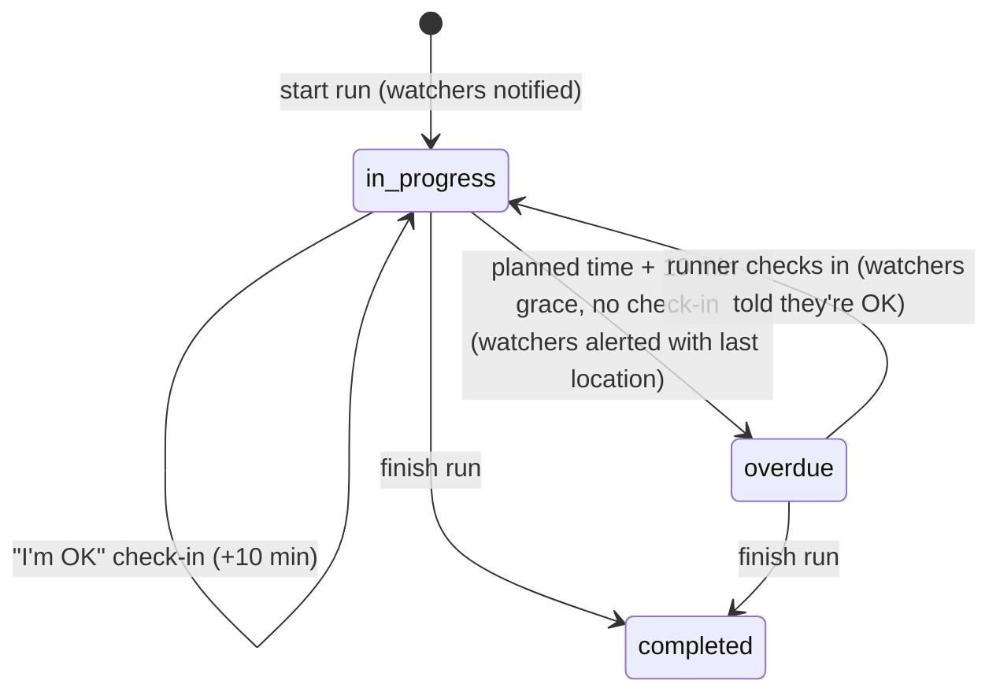

# RunHer 🏃‍♀️

A social running app for women, built around safety. Before a run you pick trusted friends as **watchers**. They're notified when you head out, can follow your live location, and are alerted automatically if you don't come back or check in on time.

Around that sits a social layer: run recaps with photos, a feed, friend requests, notifications, and a calendar for planning group runs.

## How the safety flow works

1. **Start a run.** Choose a planned duration, a location, and your watchers. Each watcher gets a notification, and a banner with a **Track** button appears on every page while you're out.
2. **Live location.** While the run is active, the browser watches the device's GPS and sends the latest position to the server every 15 seconds. Watchers see it on a map at `/track/:runId`.
3. **Check-in reminder.** When the planned time is up, the runner is reminded and gets an in-app button: *"I'm OK, add 10 minutes."*
4. **Overdue alert.** If the runner still hasn't finished or checked in 10 minutes later, the run is marked `overdue` and every watcher gets an urgent alert, the runner's last known location, and a button to call or text them.
5. **Finish.** The runner saves a recap (miles, pace, photo), the run is marked `completed`, and watchers are told they finished safely.



### Notifications

Every alert goes through one function, `notify()` in `server/notify.js`, which saves it as an in-app notification. While RunHer is open, new notifications pop up within a few seconds (and as a system notification if the tab is in the background); the rest wait under the 🔔 bell with an unread count. Text messages are an optional second channel behind `SMS_ENABLED`, so adding push notifications or Twilio later means adding a channel, not touching the safety logic.

### Overdue detection

The overdue check runs on the server every 15 seconds (`server/safety.js`), so alerts still go out if the runner's phone dies or the app is closed. Each step claims its runs with a single `UPDATE ... RETURNING` statement, so an alert is sent exactly once even if checks overlap or several server instances are running.

## Tech stack

| Layer | Tech |
|---|---|
| Frontend | React 19, React Router, Bootstrap, browser Geolocation API |
| Backend | Node.js, Express, express-session, bcrypt, Multer (photo uploads) |
| Database | PostgreSQL 14 (10 tables with foreign keys, unique and check constraints, and indexes) |
| Notifications | In-app notifications and pop-ups (Notifications API); optional SMS through Nodemailer and carrier email-to-SMS gateways |
| Infrastructure | Docker Compose (client, server, and database containers) |

```
client (React :3000) ──/api proxy──▶ server (Express :5001) ──▶ PostgreSQL
                                          │
                                          ├── safety monitor (every 15s)
                                          └── notify(): in-app notifications (+ optional SMS)
```

## Running locally

Requires Docker Desktop.

```bash
docker compose up -d
```

Then open http://localhost:3000.

- On first start the database is created from `init_data/create.sql` and filled with sample data from `init_data/insert.sql`. The demo account logins are listed at the top of that file.
- Alerts are in-app only by default. To also send text messages, put `EMAIL_USER` and `EMAIL_PASS` in `server/.env` and run `SMS_ENABLED=true docker compose up -d`.
- To test the safety flow quickly, use the **2-min test run** button (development only) and shorten the grace period: `OVERDUE_GRACE_MINUTES=1 docker compose up -d`.
- Two people need separate logins to test together: use a normal and a private window, or two browsers.
- To reset the database: `docker compose down -v && docker compose up -d`.

`server/.env` needs `POSTGRES_HOST=db`, `POSTGRES_DB`, `POSTGRES_USER`, `POSTGRES_PASSWORD`, `SESSION_SECRET`, `PORT=5001`, and optionally `EMAIL_USER`, `EMAIL_PASS` and `APP_URL`.

## Key API routes

| Method | Route | Purpose |
|---|---|---|
| `POST` | `/api/start-run` | Start a run with watchers |
| `GET` | `/api/runs/active` | Resume the current run after a refresh |
| `POST` | `/api/runs/:id/location` | Live location update (runner only) |
| `POST` | `/api/runs/:id/checkin` | "I'm OK": extend the run and cancel pending alerts |
| `GET` | `/api/runs/:id/track` | Live status (runner and watchers only) |
| `POST` | `/api/runs/finish` | Save the recap and complete the run |
| `GET` | `/api/runs/watching` | Friends' active runs you're watching |
| `GET` | `/api/notifications/live?after=` | New notifications for pop-ups, plus the unread count |

## Roadmap

- Deploy over HTTPS and add Web Push, so alerts reach watchers' phones even when RunHer is closed
- Replace email-to-SMS gateways with Twilio for reliable delivery to any carrier
- Store photos in cloud storage (S3 or GCS) instead of on the server's disk
- A mobile app, so location sharing keeps working in the background
- Store sessions in PostgreSQL so a server restart doesn't log everyone out
- Automated tests for the safety monitor and API
